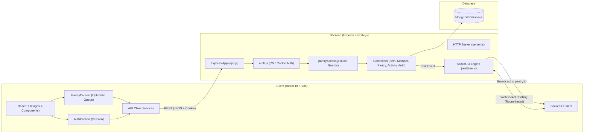

# PantryPal – Shared Pantry Tracker

> A collaborative, real-time shared pantry inventory tracking application for households, shared apartments, hostels, and office teams.

[](https://nodejs.org/)
[](https://react.dev/)
[](https://expressjs.com/)
[](https://www.mongodb.com/)
[](https://socket.io/)
[](https://vitejs.dev/)

---

## Table of Contents

1. [Project Overview](#project-overview)
2. [Problem Statement](#problem-statement)
3. [Project Objectives](#project-objectives)
4. [Key Features](#key-features)
5. [Technology Stack](#technology-stack)
6. [Application Architecture](#application-architecture)
7. [Folder Structure](#folder-structure)
8. [Authentication & Authorization](#authentication--authorization)
9. [Roles & Permissions Matrix](#roles--permissions-matrix)
10. [Inventory Management](#inventory-management)
11. [Low-Stock & Expiry Alerts](#low-stock--expiry-alerts)
12. [Activity History & Audit Trail](#activity-history--audit-trail)
13. [Notification Preferences](#notification-preferences)
14. [Socket.IO Real-Time Synchronization](#socketio-real-time-synchronization)
15. [Account Deletion & Ownership Transfer](#account-deletion--ownership-transfer)
16. [Screenshots](#screenshots)
17. [Installation & Getting Started](#installation--getting-started)
18. [Environment Configuration](#environment-configuration)
19. [Running Frontend & Backend](#running-frontend--backend)
20. [API Overview](#api-overview)
21. [Troubleshooting](#troubleshooting)
22. [Team Contributions](#team-contributions)
23. [Verified Scope & Future Improvements](#verified-scope--future-improvements)
24. [Documentation Links](#documentation-links)

---

## Project Overview

**PantryPal** is a full-stack, multi-user web application designed to track food, groceries, and household supplies across shared pantry spaces. Built with **React 18**, **Node.js**, **Express**, **MongoDB (Mongoose)**, and **Socket.IO**, PantryPal allows members of a home, office, or hostel to collaborate on a single unified inventory.

Every user has an individual account. Users can create distinct pantry workspaces (e.g., *"Kitchen Main"*, *"Office Snack Bar"*), invite existing registered users by email, assign access roles, log item details (quantity, unit, category, expiry date, low-stock threshold), and view live updates without manual page refreshes.

---

## Problem Statement

In shared living spaces, communal kitchens, and office breakrooms, roommates and colleagues frequently encounter common logistical friction:
- **Duplicate Purchases**: Individuals buy groceries without realizing a flatmate already bought the same product.
- **Unexpected Depletion**: Essential staples (milk, eggs, oil, coffee) run out because changes in quantity are not communicated immediately.
- **Food Spoilage & Waste**: Perishable ingredients get forgotten in cabinets or refrigerators past their expiration date.
- **Lack of Accountability**: When supplies disappear or inventory counts are modified, there is no history of who made the change or when.

PantryPal solves these issues by providing a shared, real-time inventory ledger with clear ownership, role-based safeguards, threshold-based restock indicators, and chronological activity tracking.

---

## Project Objectives

1. **Eliminate Redundant Purchases**: Maintain an accurate, instantly visible stock list across all accessible pantries.
2. **Minimize Food Waste**: Automatically compute days remaining until item expiration and visually flag items needing immediate use.
3. **Prevent Supply Shortages**: Track minimum stock thresholds and provide one-click restock adjustments.
4. **Enforce Safe Multi-User Collaboration**: Separate owner privileges (adding, editing, deleting items, managing members) from member privileges (adjusting stock quantities), with atomic guarantees against negative stock counts.
5. **Provide Full Traceability**: Record an immutable log of inventory additions, modifications, and quantity increments with timestamp and user attribution.

---

## Key Features

- **Pantry Workspace Isolation**: Create multiple pantries; all inventory queries, activity logs, and real-time socket events are strictly scoped to the active pantry.
- **Global Overview**: Unified views (`/inventory`, `/low-stock`, `/expiry-alerts`) allow users to inspect items across *all* pantries they belong to in one place.
- **Atomic Stock Adjustments**: Fast quantity increments and decrements via MongoDB atomic operations, protected against race conditions and negative values.
- **Optimistic UI Updates**: Rapid button clicks adjust frontend counters instantaneously while managing an internal asynchronous queue for server synchronization.
- **Real-Time Synchronization**: Changes made by any pantry member (item added, updated, deleted, restocked, or members changed) are immediately pushed to all connected members via Socket.IO rooms.
- **Categorization & Search**: Filter items by predefined categories (*Grains, Pulses, Oils, Dairy, Vegetables, Fruits, Spices, Snacks, Beverages, Other*), custom category names, stock status, or text search.
- **Status Badging**: Multi-badge status indicators (*OK, Low Stock, Expiring Soon, Expired*) update automatically based on system date and thresholds.
- **Secure HttpOnly Cookie Authentication**: JWTs are stored in secure, `HttpOnly` browser cookies with CSRF origin validation, protecting tokens from XSS theft.
- **Safe Account Deletion**: Self-service deletion workflow requiring explicit password entry and `"DELETE"` confirmation, with mandatory ownership transfer for shared pantries.
- **Responsive Dark/Light Theme**: Theme switcher with persistent `localStorage` preference and full responsive mobile/desktop navigation.

---

## Technology Stack

### Frontend
- **Framework**: React 18 (`react` 18.3.1, `react-dom` 18.3.1)
- **Bundler & Tooling**: Vite 5 (`vite` 5.4.21, `@vitejs/plugin-react` 4.7.0)
- **Routing**: React Router v6 (`react-router-dom` 6.30.6)
- **Icons**: Lucide React (`lucide-react` 0.468.0)
- **Real-Time Client**: Socket.IO Client (`socket.io-client` 4.8.4)
- **Styling**: Native CSS3 with CSS custom properties (variables), responsive flexbox/grid, and theme toggling

### Backend
- **Runtime**: Node.js (CommonJS module system)
- **Web Framework**: Express 5 (`express` 5.3.0)
- **Database & ODM**: MongoDB with Mongoose (`mongoose` 9.11.4)
- **Real-Time Engine**: Socket.IO (`socket.io` 4.8.4)
- **Authentication**: JSON Web Tokens (`jsonwebtoken` 9.0.3) & `bcryptjs` (3.0.3)
- **Security & Utilities**: `cookie-parser` (1.4.7), `cors` (2.8.6), `dotenv` (18.0.9), `express-rate-limit` (8.7.2)
- **Development Tooling**: `nodemon` (3.1.14)

---

## Application Architecture

PantryPal follows a client-server architecture with stateful real-time WebSockets and stateless REST endpoints:



### Architectural Principles
1. **Pantry-Scoped Authorization**: The backend never trusts client-supplied pantry ownership. Every pantry operation checks membership and ownership directly against MongoDB records before execution.
2. **Authoritative Server State**: While the frontend performs optimistic updates for responsive UI interactions, the backend database remains the single source of truth.
3. **Room-Scoped Real-Time Events**: Sockets join specific rooms formatted as `pantry:<pantryId>`. Broadcasts are delivered only to members of that specific pantry room.

---

## Folder Structure

```text
PantryPal/
├── .env.example                 # Root reference configuration
├── .gitignore                   # Version control exclusions
├── README.md                    # Root project documentation (this file)
├── PantryPal Shared Pantry...pdf# Project requirements specification
│
├── docs/                        # In-depth architectural guides
│   ├── API_DOCUMENTATION.md     # Full REST & Socket.IO API reference
│   ├── PROJECT_STRUCTURE.md     # Detailed directory and code layout
│   └── SETUP_GUIDE.md           # Step-by-step setup and troubleshooting
│
├── client/                      # Frontend single-page application
│   ├── .env.example             # Client environment template
│   ├── index.html               # Main HTML entry
│   ├── package.json             # Frontend dependencies & scripts
│   ├── vite.config.js           # Vite configuration
│   └── src/
│       ├── App.jsx              # React Router setup & protected routes
│       ├── main.jsx             # React entry point
│       ├── index.css            # Base styles and CSS variables
│       ├── professional.css     # Layout, theme, and component styles
│       ├── components/          # Layout, ProtectedRoute, ConfirmDialog, StatusBadge
│       ├── context/             # AuthContext, PantryContext
│       ├── data/                # Category definitions (inventoryOptions.js)
│       ├── pages/               # Dashboard, Inventory, LowStock, ExpiryAlerts, Members, etc.
│       ├── services/            # authApi, pantryApi, inventoryApi, activityApi, realtime, session
│       └── utils/               # Date helpers, dashboard formatting, image resizer
│
└── server/                      # Backend API server
    ├── .env.example             # Server environment template
    ├── package.json             # Backend dependencies & scripts
    ├── README.md                # Server reference notes
    └── src/
        ├── app.js               # Express application configuration & CORS
        ├── realtime.js          # Socket.IO connection & room management
        ├── server.js            # Server entry, HTTP listener, JWT auto-secret
        ├── config/              # MongoDB connection (db.js)
        ├── controllers/         # authController, pantryController, itemController, etc.
        ├── middleware/          # auth.js, pantryAccess.js
        ├── models/              # User.js, Pantry.js, PantryItem.js, InventoryActivity.js
        └── routes/              # authRoutes, pantryRoutes, itemRoutes, activityRoutes
```

---

## Authentication & Authorization

### Cookie-Based JWT Flow
1. **Registration / Login**: When a user registers (`POST /api/auth/register`) or logs in (`POST /api/auth/login`), the server issues a signed JWT containing `{ sub: user._id }`.
2. **HttpOnly Cookie**: The token is written into a cookie named `pantrypal_token`:
   - `httpOnly: true`: Cannot be accessed by client-side JavaScript, preventing token theft via XSS attacks.
   - `path: "/"`: Available across all API routes.
   - `sameSite`: Configured to `"lax"` in development and `"none"` in production.
   - `secure`: Set to `true` when `NODE_ENV === "production"` (requires HTTPS).
3. **Session Verification**: `GET /api/auth/me` verifies the cookie on app launch. If valid, the user state is restored. If expired (`TokenExpiredError`), the server responds with `401 Unauthorized`.
4. **CSRF & Origin Defense**: State-changing operations (`POST`, `PUT`, `PATCH`, `DELETE`) require the incoming `Origin` header to match the configured `CLIENT_URL`.
5. **Rate Limiting**: In-memory rate limiting restricts authentication endpoints to 10 attempts per 15 minutes per IP address.

---

## Roles & Permissions Matrix

PantryPal implements a dual-level authorization model:

1. **System Level**: All users share one unified account model (there are no separate "Buyer" or "Customer" portals).
2. **Pantry Level**: A user's permissions are dynamically determined per pantry:
   - **Pantry Owner**: The creator of the pantry (or the designated successor after ownership transfer).
   - **Pantry Member**: A registered user invited to and added to the pantry.

| Capability / Action | Endpoint | Pantry Owner | Pantry Member | Non-Member / Public |
| :--- | :--- | :---: | :---: | :---: |
| Register / Login / Logout | `/api/auth/*` | Yes | Yes | Public |
| View / Update Notification Preferences | `/api/auth/preferences` | Yes | Yes | No |
| Delete Own Account | `/api/auth/account` | Yes | Yes | No |
| Create New Pantry | `POST /api/pantries` | Yes | Yes | No |
| List User's Pantries | `GET /api/pantries` | Yes | Yes | No |
| Delete Pantry & Inventory | `DELETE /api/pantries/:id` | **Yes** | No | No |
| View Pantry Members | `GET /api/pantries/:id/members` | **Yes** | **Yes** | No |
| Add Member to Pantry | `POST /api/pantries/:id/members` | **Yes** | No | No |
| Remove Member from Pantry | `DELETE /api/pantries/:id/members/:memberId` | **Yes** | No | No |
| View Pantry Inventory Items | `GET /api/pantries/:id/items` | **Yes** | **Yes** | No |
| View Global Inventory | `GET /api/inventory` | **Yes** | **Yes** | No |
| Add Inventory Item | `POST /api/pantries/:id/items` | **Yes** | No | No |
| Edit Item Details (Name, Unit, etc.) | `PATCH /api/items/:id` | **Yes** | No | No |
| Delete Inventory Item | `DELETE /api/items/:id` | **Yes** | No | No |
| **Adjust Stock Quantity (+ / −)** | `PATCH /api/items/:id/quantity` | **Yes** | **Yes** | No |
| View Activity History | `GET /api/pantries/:id/activity` | **Yes** | **Yes** | No |

---

## Inventory Management

### Item Attributes
Each item tracked in a pantry includes:
- `name`: Clean string (e.g., *"Brown Rice"*).
- `category`: Category string (predefined list or custom string up to 60 characters).
- `quantity`: Current numeric stock balance (cannot be negative).
- `unit`: Measurement unit (e.g., `kg`, `pcs`, `litres`, `boxes`).
- `expiryDate`: ISO date string or `null` for non-perishable goods.
- `lowStockThreshold`: Minimum threshold number; quantities at or below this value trigger low-stock alerts.
- `createdBy`: Reference to the `User` who added the item.

### Atomic Quantity Updates & Underflow Protection
Quantity changes are processed using MongoDB's `$inc` operator:
```javascript
const filter = { _id: itemId, pantryId: pantryId };
if (change < 0) {
  filter.quantity = { $gte: Math.abs(change) };
}
await PantryItem.findOneAndUpdate(filter, { $inc: { quantity: change } });
```
If a user attempts to decrement stock beyond what is physically available, the query matches 0 documents and returns `409 Conflict` (*"Quantity cannot be reduced below zero"*).

---

## Low-Stock & Expiry Alerts

### Low-Stock Calculation
An item is flagged as **Low Stock** when:
$$\text{quantity} \le \text{lowStockThreshold}$$
- Accessible from `/low-stock` (globally) or `/pantries/:id/low-stock` (scoped to a pantry).
- The Low Stock interface provides an instant **Add Stock** modal calculating the suggested minimum replenishment needed:
$$\text{Suggested Restock} = \max(1, \text{threshold} - \text{quantity} + 1)$$

### Expiry Date Calculation & Categorization
Food freshness is determined by comparing `expiryDate` with the current local date:
$$\text{daysLeft} = \text{difference in UTC calendar days}$$

Items are organized into three dedicated categories:
1. **Expired**: $\text{daysLeft} < 0$ (Requires immediate disposal or removal).
2. **Expiring Soon**: $0 \le \text{daysLeft} \le 7$ (Requires prompt consumption).
3. **Safe**: $\text{daysLeft} > 7$ (Adequate shelf life remaining).

Items can simultaneously carry multiple statuses (for example, an item can be both **Low Stock** and **Expiring Soon**).

---

## Activity History & Audit Trail

Every state-changing inventory operation automatically records an immutable entry in the `InventoryActivity` collection:

- **Actions Logged**:
  - `ITEM_ADDED`: Triggered when an owner creates a new item.
  - `ITEM_EDITED`: Triggered when item details are updated.
  - `ITEM_DELETED`: Triggered when an item is removed.
  - `QUANTITY_INCREASED`: Triggered on stock replenishment.
  - `QUANTITY_DECREASED`: Triggered on stock consumption.
- **Data Captured**: `pantryId`, `itemId`, `userId`, `changeAmount`, `action`, `note`, and `createdAt` timestamp.
- **Account Deletion Handling**: If a user deletes their account, historical activity entries are preserved for audit integrity, with `userId` safely set to `null` (*"Unknown user"*).

---

## Notification Preferences

Users can customize which updates they want to receive via `/settings`:
- **Low-stock alerts**: Notification toggle for items reaching minimum thresholds.
- **Expiry reminders**: Notification toggle for upcoming and expired items.
- **Member activity**: Notification toggle for changes made to shared inventory.

Preferences are saved to the user's MongoDB profile via `PATCH /api/auth/preferences` and restored upon login.

---

## Socket.IO Real-Time Synchronization

PantryPal uses **Socket.IO (v4)** to deliver bidirectional real-time updates across connected browser sessions:

### Implementation Details
- **Handshake Authentication**: Socket.IO verifies the `pantrypal_token` HttpOnly cookie upon connection. Unauthenticated connections are rejected.
- **Room Scoping**: Active connections join rooms named `pantry:<pantryId>`. Real-time events are dispatched only to sockets within that pantry's room.
- **Optimistic Concurrency**: The frontend `PantryContext` implements a request queue that displays pending changes immediately and reconciles them with incoming `inventory:quantity-updated` broadcasts.
- **Automatic Reconnection**: If the network connection drops, the client automatically attempts reconnection and queries fresh pantry and inventory data upon reconnecting (`realtime:status: connected`).
- **Access Revocation**: When a pantry member is removed by the owner, the server forcibly removes that user's sockets from the room and emits `pantry:access-revoked`.

> [!NOTE]
> Socket.IO operates via direct Node.js HTTP server integration. Multi-node clustering with Redis Pub/Sub is not included in the current single-instance deployment.

---

## Account Deletion & Ownership Transfer

PantryPal provides a safe account deletion flow (`DELETE /api/auth/account`) enforcing data integrity:

1. **Identity Re-Verification**: Requires the user's current password and an exact confirmation string (`"DELETE"`).
2. **Ownership Transfer for Shared Pantries**:
   - If the user owns a pantry with other members, the user **must** choose a new owner from the existing member list for each shared pantry.
   - Ownership transfers cannot be assigned to non-members or the departing user.
3. **Private Pantry Cleanup**:
   - Pantries owned exclusively by the user (with no other members) are deleted along with their items and activity logs.
4. **Data Hygiene & Anonymization**:
   - The user is removed from `memberIds` across all pantries.
   - Historical item creations have `createdBy` set to `null`.
   - Historical activities have `userId` set to `null`.
5. **Multi-Document Transactions**:
   - Deletion executes inside a MongoDB transaction session. If any step fails, changes are completely rolled back.
   - *Requirement*: MongoDB replica set or MongoDB Atlas is required for transaction support. Standalone instances return `503 Service Unavailable`.

---

## Screenshots

> *Screenshots will appear here once captured from the running application.*

### 1. Dashboard View
```text
+-----------------------------------------------------------------------------------+
|  [PantryPal Brand]        Dashboard - Quick Overview         [Theme] [User Menu]  |
+-----------------------------------------------------------------------------------+
|  +-------------------+  +-------------------+  +--------------------------------+ |
|  | Total Pantries: 2 |  | Total Items: 38   |  | Low Stock Warnings: 3          | |
|  +-------------------+  +-------------------+  +--------------------------------+ |
|                                                                                   |
|  [ Recent Activity Feed ]                  [ Expiring Soon Table ]                |
|  - Basmati Rice: -1 by Jane Doe            - Whole Milk (Expires in 2 days)       |
|  - Olive Oil: +2 by John Smith             - Fresh Spinach (Expires tomorrow)     |
+-----------------------------------------------------------------------------------+
```
*Description: Overview of accessible pantries, urgent restock warnings, and recent activity.*

---

### 2. Pantry Inventory Workspace
```text
+-----------------------------------------------------------------------------------+
|  Kitchen Main Pantry    [+ Add Item (Owner Only)]     [Manage Members]            |
+-----------------------------------------------------------------------------------+
|  [Search items...]   [Filter: Category v]   [Filter: Status v]                    |
|  +------------------------------------------------------------------------------+ |
|  | Item Name    | Category | Quantity     | Expiry Date | Status    | Actions   | |
|  |--------------+----------+--------------+-------------+-----------+-----------| |
|  | Whole Milk   | Dairy    | [-] 1 pcs [+]| 2026-11-04  | [Expiring]| [Edit|Del]| |
|  | Olive Oil    | Oils     | [-] 3 btl [+]| 2027-01-15  | [OK]      | [Edit|Del]| |
|  | Rolled Oats  | Grains   | [-] 0 kg  [+]| 2026-12-01  | [LowStock]| [Edit|Del]| |
|  +------------------------------------------------------------------------------+ |
+-----------------------------------------------------------------------------------+
```
*Description: Interactive inventory table with search, category filtering, quantity steppers, and owner controls.*

---

### 3. Low-Stock Restock Modal
```text
+------------------------------------------------------+
|  Add Stock: Rolled Oats                        [ X ] |
+------------------------------------------------------+
|  Available now:    0 kg                              |
|  Minimum required: 2 kg                              |
|                                                      |
|  Quantity to add:  [ 3 ] kg                          |
|                                                      |
|  [ Cancel ]                     [ + Update Stock ]   |
+------------------------------------------------------+
```
*Description: Quick-restock modal pre-calculating the minimum items needed to clear low-stock status.*

---

### 4. Pantry Member Management
```text
+-----------------------------------------------------------------------------------+
|  Pantry Members (3 members)                     [ + Add Member (Owner Only) ]     |
+-----------------------------------------------------------------------------------+
|  +------------------------------------------------------------------------------+ |
|  | (JD) Jane Doe        jane@example.com         [ Owner Badge ]   (Protected)  | |
|  | (JS) John Smith      john@example.com         [ Member Badge ]  [ Remove ]   | |
|  | (AL) Alice Lee       alice@example.com        [ Member Badge ]  [ Remove ]   | |
|  +------------------------------------------------------------------------------+ |
+-----------------------------------------------------------------------------------+
```
*Description: Member list displaying assigned roles and controls for inviting or removing members.*

---

## Installation & Getting Started

### Prerequisites
- **Node.js**: v18.0.0 or later (v20 LTS recommended)
- **npm**: v8.0.0 or later
- **MongoDB**: v5.0 or later (Local installation or MongoDB Atlas cluster)

### Step 1: Clone the Repository
```powershell
git clone https://github.com/your-username/PantryPal.git
cd PantryPal
```

### Step 2: Install Backend Dependencies
```powershell
cd server
npm install
cd ..
```

### Step 3: Install Frontend Dependencies
```powershell
cd client
npm install
cd ..
```

---

## Environment Configuration

### 1. Server Environment (`server/.env`)
Create `server/.env` by copying `server/.env.example`:

```powershell
Copy-Item server/.env.example server/.env
```

Configure the following variables:
```env
PORT=5000
MONGO_URI=mongodb://127.0.0.1:27017/pantrypal
JWT_SECRET=
JWT_EXPIRES_IN=7d
JWT_COOKIE_EXPIRES_IN_DAYS=7
CLIENT_URL=http://localhost:5173
```

- **`JWT_SECRET`**: In development, if left empty, the server automatically generates and saves a secure 64-byte `base64url` key into `server/.env`. In production (`NODE_ENV=production`), it must be explicitly configured.
- **`MONGO_URI`**: Set to your local MongoDB daemon or MongoDB Atlas connection string.
- **`CLIENT_URL`**: Set to the frontend origin (or comma-separated origins).

### 2. Client Environment (`client/.env`)
Create `client/.env` by copying `client/.env.example`:

```powershell
Copy-Item client/.env.example client/.env
```

Configure the API URL:
```env
VITE_API_URL=http://localhost:5000
```

---

## Running Frontend & Backend

To run both services concurrently during development, start them in separate terminals:

### Terminal 1: Backend API Server
```powershell
cd server
npm run dev
```
*Starts `nodemon src/server.js` on port `5000`.*

### Terminal 2: Frontend Web App
```powershell
cd client
npm run dev
```
*Starts the Vite dev server at `http://localhost:5173`.*

### Building for Production
```powershell
# Build client bundle
cd client
npm run build

# Start production server
cd ../server
npm start
```

---

## API Overview

All routes are prefixed with `/api`. For complete request/response schemas, consult [`docs/API_DOCUMENTATION.md`](file:///docs/API_DOCUMENTATION.md).

| Method | Endpoint | Authorization | Description |
| :--- | :--- | :--- | :--- |
| `GET` | `/api/health` | Public | Backend health check |
| `POST` | `/api/auth/register` | Rate-limited (10/15m) | Register a new user |
| `POST` | `/api/auth/login` | Rate-limited (10/15m) | Log in and receive session cookie |
| `GET` | `/api/auth/me` | Authenticated | Retrieve current user profile |
| `POST` | `/api/auth/logout` | Public | Clear session cookie |
| `GET` | `/api/auth/preferences` | Authenticated | Retrieve user notification settings |
| `PATCH` | `/api/auth/preferences` | Authenticated | Update user notification settings |
| `DELETE` | `/api/auth/account` | Authenticated | Delete account and transfer pantries |
| `GET` | `/api/pantries` | Authenticated | List all accessible pantries |
| `POST` | `/api/pantries` | Authenticated | Create a new pantry workspace |
| `DELETE` | `/api/pantries/:id` | Pantry Owner | Delete pantry, items, and activity |
| `GET` | `/api/pantries/:id/members` | Pantry Member | List members of a pantry |
| `POST` | `/api/pantries/:id/members` | Pantry Owner | Add registered user to pantry |
| `DELETE` | `/api/pantries/:id/members/:memberId` | Pantry Owner | Remove member from pantry |
| `GET` | `/api/inventory` | Authenticated | Get all items across accessible pantries |
| `GET` | `/api/pantries/:id/items` | Pantry Member | Get items for a single pantry |
| `POST` | `/api/pantries/:id/items` | Pantry Owner | Add item to pantry inventory |
| `PATCH` | `/api/items/:id` | Pantry Owner | Update item details |
| `DELETE` | `/api/items/:id` | Pantry Owner | Delete item from pantry |
| `PATCH` | `/api/items/:id/quantity` | **Pantry Member** | Atomically increment/decrement stock |
| `GET` | `/api/pantries/:id/activity` | Pantry Member | View chronological pantry activity |

---

## Troubleshooting

| Problem | Cause | Resolution |
| :--- | :--- | :--- |
| `EADDRINUSE: :::5000` | Port 5000 is occupied | Terminate the process using port 5000 or change `PORT` in `server/.env`. |
| `MongoDB connection failed` | MongoDB is not running | Start the MongoDB service (`Start-Service MongoDB` on Windows) or check connection URI. |
| `403 Request origin not allowed` | CORS/CSRF mismatch | Ensure `CLIENT_URL` in `server/.env` exactly matches your frontend URL (e.g. `http://localhost:5173`). |
| Account Deletion returns `503` | Standalone MongoDB | MongoDB multi-document transactions require a replica set or MongoDB Atlas. See [`docs/SETUP_GUIDE.md`](file:///docs/SETUP_GUIDE.md). |
| Immediate logout / session expired | Browser cookies blocked | Ensure cookies are enabled for `localhost`. Verify system clock synchronization. |
| Changes not syncing live | Sockets disconnected | Verify Socket.IO connectivity in browser network tools and ensure both users belong to the same pantry. |

---

## Team Contributions

This project was developed collaboratively. Placeholders for team members and responsibilities:

- **Team Member 1**: `[Full Name]` – Backend architecture, REST APIs, database schemas, and Socket.IO real-time engine.
- **Team Member 2**: `[Full Name]` – Frontend UI development, React contexts, state management, and responsive styling.
- **Team Member 3**: `[Full Name]` – Authentication, authorization middleware, input validation, and security testing.
- **Team Member 4**: `[Full Name]` – UI/UX design tokens, notification preferences, and technical documentation.

---

## Verified Scope & Future Improvements

### Verified Current Scope
- Full CRUD for pantries and items with owner/member permission boundaries.
- Atomic quantity updates preventing negative inventory.
- Real-time updates via Socket.IO room subscriptions.
- Safe account deletion with transactional ownership transfer.
- Non-transactional pantry deletion rollback fallback.

### Verified Limitations (Not Currently Implemented)
- **Automated Tests**: Package scripts currently contain placeholder test commands (`echo "Error: no test specified"`).
- **Change Password**: The `/change-password` route renders a frontend demo form without a backing API endpoint.
- **External Notifications**: Notification preferences are saved to the user profile, but third-party email/SMS notification delivery is not yet integrated.
- **Shopping / Commerce**: By design, PantryPal contains no buyer roles, cart checkout, payment gateways, or reservation systems.

### Future Roadmap
1. **Automated Test Suite**: Implement unit tests (Jest/Supertest for API, Vitest/React Testing Library for frontend).
2. **Backend Password Change API**: Add `PATCH /api/auth/password` with current password verification.
3. **Barcode Scanning**: Integrate mobile barcode lookup (OpenFoodFacts API) for rapid item addition.
4. **Email / Push Notifications**: Integrate SendGrid or Firebase Cloud Messaging for expiry and low-stock alerts.
5. **CSV / PDF Export**: Enable pantry inventory export for physical auditing and reporting.
6. **Socket.IO Redis Adapter**: Enable horizontal scaling of WebSocket connections across multiple server nodes.

---

## Documentation Links

For further technical details, explore the complete documentation suite:

- 📖 [**API Documentation** (`docs/API_DOCUMENTATION.md`)](file:///docs/API_DOCUMENTATION.md) – Comprehensive endpoint and Socket.IO event reference.
- 🏗️ [**Project Structure & Architecture** (`docs/PROJECT_STRUCTURE.md`)](file:///docs/PROJECT_STRUCTURE.md) – Directory layout, database schemas, and data flow.
- 🛠️ [**Setup & Installation Guide** (`docs/SETUP_GUIDE.md`)](file:///docs/SETUP_GUIDE.md) – Step-by-step local execution and troubleshooting.
