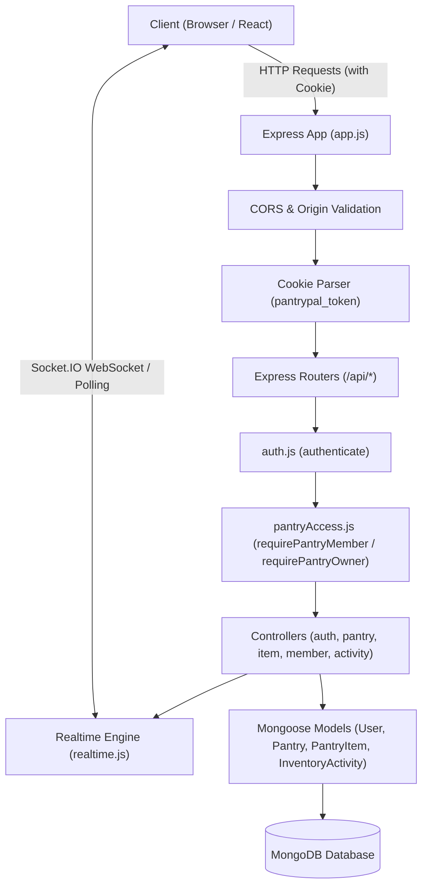
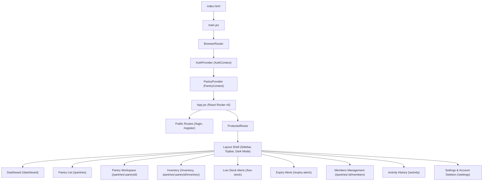
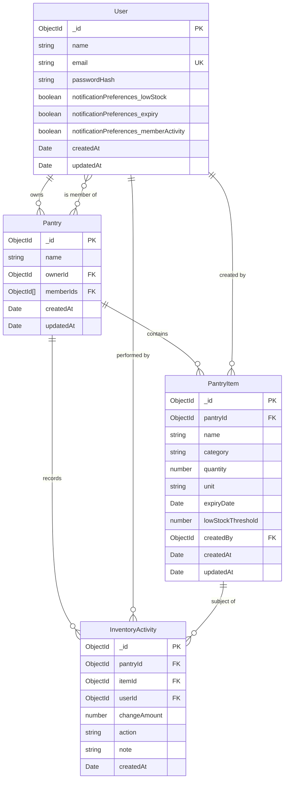

# PantryPal Project Structure & Architecture

This document provides a comprehensive overview of the code organization, directory layout, architectural patterns, and data flow of **PantryPal – Shared Pantry Tracker**.

---

## 1. Directory Tree Overview

```text
PantryPal/
├── .env.example                 # Root reference environment variable template
├── .gitignore                   # Git exclusion rules for secrets and build artifacts
├── PantryPal Shared Pantry...pdf# Original project requirements specification
├── README.md                    # Main project overview and getting started guide
│
├── docs/                        # Detailed technical documentation
│   ├── API_DOCUMENTATION.md     # Complete REST and Socket.IO API reference
│   ├── PROJECT_STRUCTURE.md     # Architectural guide and file inventory (this file)
│   └── SETUP_GUIDE.md           # Step-by-step local setup and environment configuration
│
├── client/                      # Frontend single-page application (React 18 + Vite)
│   ├── .env.example             # Client environment variable template
│   ├── index.html               # Vite HTML entry point
│   ├── package.json             # Frontend dependencies and npm scripts
│   ├── vite.config.js           # Vite build and plugin configuration
│   └── src/
│       ├── App.jsx              # React Router v6 routing and layout configuration
│       ├── main.jsx             # React DOM root render and top-level providers
│       ├── index.css            # Base stylesheet reset and design tokens
│       ├── professional.css     # UI component styles, theme variables, and layout classes
│       │
│       ├── components/          # Reusable UI presentation and layout components
│       │   ├── ConfirmDialog.jsx    # Modal dialog for confirmation before destructive actions
│       │   ├── ErrorBoundary.jsx    # React error boundary component for crash handling
│       │   ├── Layout.jsx           # Main application shell: sidebar, topbar, theme toggle
│       │   ├── ProtectedRoute.jsx   # Route guard enforcing authenticated sessions
│       │   └── StatusBadge.jsx      # Multi-state badge (OK, Low Stock, Expiring Soon, Expired)
│       │
│       ├── context/             # Global React state management
│       │   ├── AuthContext.jsx      # Authentication state, session check, login/register/logout
│       │   └── PantryContext.jsx    # Selected pantry, inventory lists, real-time sync, optimistic updates
│       │
│       ├── data/                # Static configuration and domain datasets
│       │   └── inventoryOptions.js  # Predefined food and supply category list
│       │
│       ├── pages/               # Top-level route views
│       │   ├── Activity.jsx         # Chronological pantry inventory audit trail
│       │   ├── ChangePassword.jsx   # Change password view (frontend demo form)
│       │   ├── Dashboard.jsx        # Summary metrics, urgent stock alerts, and quick actions
│       │   ├── ExpiryAlerts.jsx     # Categorized view: Expired, Expiring Soon, Safe
│       │   ├── Inventory.jsx        # Full inventory table with filters, search, modal CRUD
│       │   ├── Login.jsx            # User sign-in page
│       │   ├── LowStock.jsx         # Critical inventory view with instant restock modal
│       │   ├── Members.jsx          # Member management, role badges, member add/remove
│       │   ├── PantryList.jsx       # Workspace hub: view accessible pantries and create new ones
│       │   ├── PantryWorkspace.jsx  # Contextual pantry workspace view
│       │   ├── Profile.jsx          # Authenticated user profile summary
│       │   ├── Register.jsx         # New user registration page
│       │   └── Settings.jsx         # Account settings, notification preferences, account deletion
│       │
│       ├── services/            # HTTP and WebSocket communication layers
│       │   ├── activityApi.js       # Activity log fetching client
│       │   ├── authApi.js           # Authentication, preferences, and account deletion endpoints
│       │   ├── inventoryApi.js      # Pantry and global inventory CRUD + quantity adjustment
│       │   ├── pantryApi.js         # Pantry creation, listing, deletion, and membership APIs
│       │   ├── realtime.js          # Socket.IO client instance, room subscriptions, and event bus
│       │   └── session.js           # Shared 401 session-expired event dispatcher
│       │
│       └── utils/               # Helper utilities
│           ├── dashboardTime.js     # Greeting and current date formatting
│           ├── inventoryDates.js    # Days-until-expiry calculations and date formatting
│           └── resizeImage.js       # Client-side image thumbnail utility helper
│
└── server/                      # Backend API server (Node.js + Express + MongoDB)
    ├── .env.example             # Server environment variable template
    ├── package.json             # Backend dependencies and npm scripts
    ├── README.md                # Legacy backend quickstart note
    └── src/
        ├── app.js               # Express application configuration, CORS, cookies, route mounting
        ├── realtime.js          # Socket.IO initialization, room scoping, and event dispatchers
        ├── server.js            # HTTP server startup, automatic JWT secret handling, port binding
        │
        ├── config/              # Infrastructure configuration
        │   └── db.js            # Mongoose MongoDB connection handler
        │
        ├── controllers/         # HTTP request handlers and business logic
        │   ├── activityController.js# Inventory activity query handler
        │   ├── authController.js    # Register, login, session, preferences, account deletion
        │   ├── itemController.js    # Inventory CRUD, quantity increments, validation
        │   ├── memberController.js  # Add member, remove member, list members
        │   └── pantryController.js  # Create, list, and delete pantries
        │
        ├── middleware/          # Express request interceptors
        │   ├── auth.js          # JWT cookie verification and user hydration
        │   └── pantryAccess.js  # requirePantryMember and requirePantryOwner authorization guards
        │
        ├── models/              # Mongoose database schemas
        │   ├── InventoryActivity.js # Audit trail schema with action enums and notes
        │   ├── Pantry.js            # Pantry entity schema with ownerId and memberIds
        │   ├── PantryItem.js        # Inventory item schema with stock levels and expiry dates
        │   └── User.js              # User account schema with passwordHash and notification prefs
        │
        └── routes/              # Express route declarations
            ├── activityRoutes.js    # GET /api/pantries/:id/activity
            ├── authRoutes.js        # /api/auth routes (auth, preferences, deletion)
            ├── itemRoutes.js        # /api/inventory, /api/pantries/:id/items, /api/items/:id
            └── pantryRoutes.js      # /api/pantries, /api/pantries/:id/members
```

---

## 2. Backend Architecture

The backend follows an Express layered architecture separating concerns into entry point, configuration, routing, middleware, controllers, and persistence models.



### Key Components

1. **HTTP Server (`server/src/server.js`)**:
   - Manages environment configuration.
   - Automatically generates and persists a cryptographically secure 64-byte `JWT_SECRET` in `server/.env` if missing during local development.
   - Enforces explicit `JWT_SECRET` configuration in production.
   - Creates the native Node.js HTTP server and attaches the Socket.IO instance.

2. **Express Application Setup (`server/src/app.js`)**:
   - Configures CORS with explicit origin matching against `CLIENT_URL` (supporting comma-separated origins and `http://127.0.0.1:5173` fallback).
   - Validates the `Origin` header on state-changing requests (`POST`, `PUT`, `PATCH`, `DELETE`) as an additional CSRF defense.
   - Registers `cookieParser()` and `express.json()` middlewares.
   - Mounts health check endpoint `GET /api/health` and all feature routers.

3. **Authentication Middleware (`server/src/middleware/auth.js`)**:
   - Reads the JWT from the HttpOnly cookie named `pantrypal_token`.
   - Verifies the signature using `process.env.JWT_SECRET`.
   - Loads the corresponding user from MongoDB and attaches it to `req.user`.
   - Distinguishes expired tokens (`TokenExpiredError`) from invalid signatures.

4. **Access Control Middleware (`server/src/middleware/pantryAccess.js`)**:
   - `requirePantryMember`: Validates the pantry ObjectId, loads the pantry from MongoDB, confirms that `req.user._id` exists in `pantry.memberIds`, and binds the verified entity to `req.pantry`.
   - `requirePantryOwner`: Enforces that `req.pantry.ownerId` equals `req.user._id`.

5. **Real-Time Integration (`server/src/realtime.js`)**:
   - Authenticates incoming Socket.IO handshakes via the `pantrypal_token` cookie.
   - Organizes socket connections into pantry-specific rooms (`pantry:<pantryId>`).
   - Verifies membership dynamically before allowing a socket to join a pantry room.
   - Exposes helpers for event emission (`emitPantryEvent`), revoking room access on member removal (`revokePantryAccess`), closing rooms on deletion (`closePantryRoom`), and disconnecting users on account deletion (`disconnectUser`).

---

## 3. Frontend Architecture

The frontend is a single-page application built with React 18 and bundled with Vite.



### Key Frontend Layers

1. **State Management**:
   - `AuthContext`: Holds current user profile, exposes `login`, `register`, `logout`, and `deleteAccount`, and orchestrates real-time connection lifecycle based on authentication status.
   - `PantryContext`: Manages the list of accessible pantries, the active pantry selection, the item inventory for the selected pantry, and real-time subscription synchronization. Implements an optimistic update queue for rapid quantity adjustments.

2. **Service Layer**:
   - Modular API clients (`authApi.js`, `pantryApi.js`, `inventoryApi.js`, `activityApi.js`) wrapped with `fetch` and `credentials: 'include'`.
   - Centralized session expiration handling (`session.js`) that dispatches window events to gracefully redirect unauthenticated users to `/login`.

3. **Real-Time Layer (`client/src/services/realtime.js`)**:
   - Initializes a singleton `socket.io-client` connection to `VITE_API_URL` with cookie credentials.
   - Implements an internal publish-subscribe event bus.
   - Dispatches socket join requests for all pantries the user belongs to.
   - Automatically rejoins rooms and refreshes state on reconnection.

---

## 4. Database Models & Schema Design



### Schema Characteristics

- **`User`**:
  - `email` is indexed as unique and normalized to lowercase.
  - `passwordHash` has `select: false` to prevent accidental disclosure during queries.
  - `notificationPreferences` stores boolean preferences for low stock, expiry reminders, and member activity.
- **`Pantry`**:
  - `ownerId` references `User`.
  - `memberIds` is an array of `User` ObjectIds.
  - A pre-validate hook ensures that `ownerId` is automatically included in `memberIds` and deduplicated.
- **`PantryItem`**:
  - `pantryId` is indexed to optimize queries scoped to a pantry.
  - `category` is a string with a 60-character maximum length.
  - `quantity` and `lowStockThreshold` enforce a minimum value of `0`.
  - `expiryDate` defaults to `null` for non-perishable goods.
- **`InventoryActivity`**:
  - `pantryId` and `createdAt` are indexed for fast chronological queries.
  - `action` is restricted to enum: `["ITEM_ADDED", "ITEM_EDITED", "ITEM_DELETED", "QUANTITY_INCREASED", "QUANTITY_DECREASED"]`.
  - Soft-nullification: if an account is deleted, historical activities set `userId: null` rather than deleting audit history.

